# Testes funcionais manuais (CT21 a CT30)

Cada caso foi executado no Google Chrome seguindo o procedimento abaixo. Os prints estão na pasta [`prints/`](prints/).

## CT21 – Navegar da página inicial para a consulta de vagas

**Pré-condição:** Sistema aberto na página inicial.

**Procedimento:**

1. O ator acessa a página inicial.
2. O ator clica em “Consultar Vagas” no menu.
3. O sistema exibe a página “Vagas Disponíveis”.

**Dados de entrada:** Nenhum.

**Saída esperada:** Página de vagas com filtros e as 6 vagas fixas.

**Saída encontrada:** Página de vagas com filtros e as 6 vagas fixas.

**Prioridade:** Média · **Resultado:** Aprovado

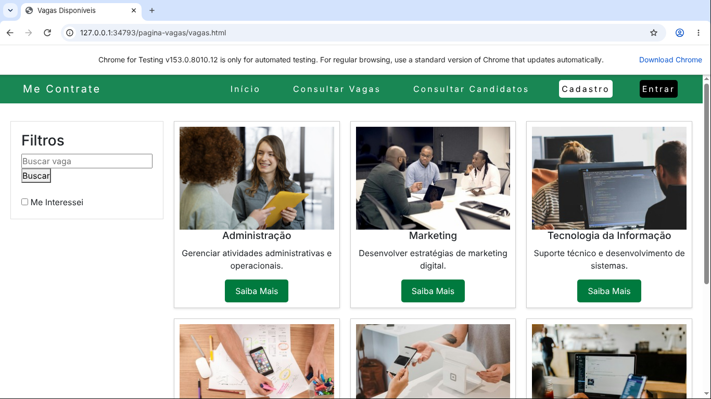

## CT22 – Ver detalhes de uma vaga

**Pré-condição:** Página de vagas aberta.

**Procedimento:**

1. O ator clica em “Saiba Mais” na vaga “Administração”.
2. O sistema abre o modal de detalhes.

**Dados de entrada:** Vaga “Administração” (empresa ABC Corp).

**Saída esperada:** Modal com título, descrição, empresa, requisitos, salário e contato.

**Saída encontrada:** O modal mostra título, descrição, requisitos, salário e contato, mas não mostra a empresa (defeito D04).

**Prioridade:** Média · **Resultado:** Reprovado

## CT23 – Ver detalhes de um candidato

**Pré-condição:** Página “Consultar Candidatos” aberta.

**Procedimento:**

1. O ator localiza a candidata “Maria Oliveira”.
2. O ator clica em “Ver Detalhes”.
3. O sistema abre o modal com os dados.

**Dados de entrada:** Candidata Maria Oliveira.

**Saída esperada:** Modal com nome, vaga, escolaridade e contato.

**Saída encontrada:** Modal com “Maria Oliveira | Designer Gráfico | Graduação em Design | maria.oliveira@email.com”.

**Prioridade:** Média · **Resultado:** Aprovado

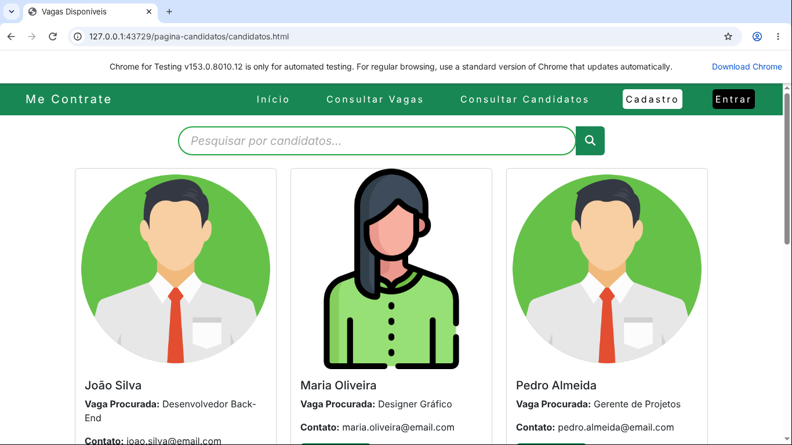
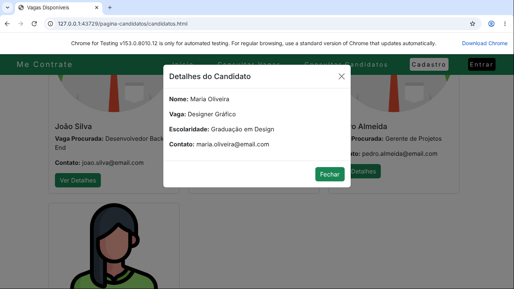

## CT24 – Cadastrar empresa com e-mail já cadastrado

**Pré-condição:** Empresa “Tech Minas” já cadastrada com rh@techminas.com.br.

**Procedimento:**

1. O ator acessa o cadastro de empresa.
2. O ator informa outra empresa com o mesmo e-mail.
3. O ator clica em “Cadastrar”.

**Dados de entrada:** Outra Empresa, rh@techminas.com.br, demais campos válidos.

**Saída esperada:** O sistema recusa o cadastro e informa que o e-mail já está em uso.

**Saída encontrada:** “Cadastro realizado com sucesso!”: a base fica com duas empresas com o mesmo e-mail (defeito D05).

**Prioridade:** Alta · **Resultado:** Reprovado

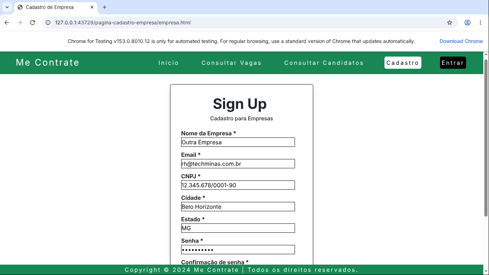
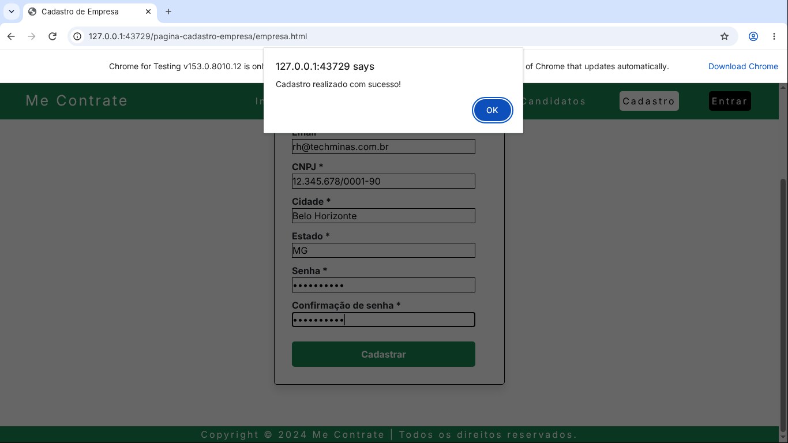

## CT25 – Ver o perfil de uma empresa logada

**Pré-condição:** Empresa “Tech Minas” logada.

**Procedimento:**

1. O ator clica em “Meu Perfil”.
2. O sistema exibe os dados do usuário logado.

**Dados de entrada:** Sessão da empresa Tech Minas.

**Saída esperada:** Nome, e-mail, CNPJ, cidade e estado da empresa.

**Saída encontrada:** Tech Minas, rh@techminas.com.br, 12.345.678/0001-90, Belo Horizonte, MG. Observação: o console registra um erro de script (defeito D03), sem efeito visível nesta tela.

**Prioridade:** Média · **Resultado:** Aprovado

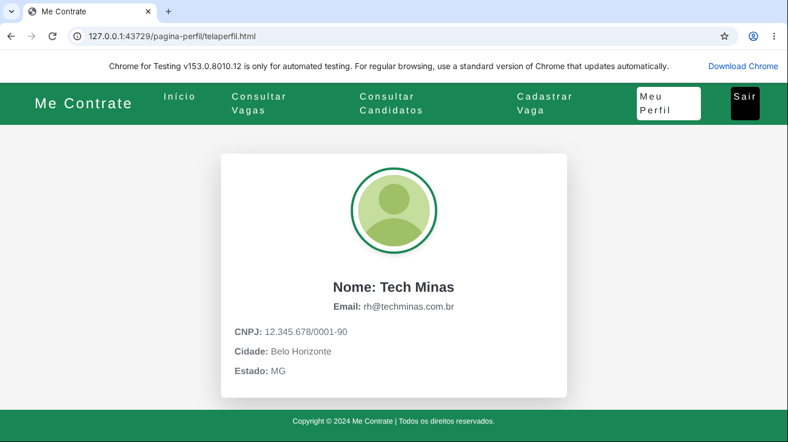

## CT26 – Sair do sistema pela página de perfil

**Pré-condição:** Empresa logada, na página “Meu Perfil”.

**Procedimento:**

1. O ator clica em “Sair”.
2. O sistema encerra a sessão.
3. O sistema exibe a confirmação.
4. O sistema volta à página inicial.

**Dados de entrada:** Sessão da empresa Tech Minas.

**Saída esperada:** Mensagem “Você saiu com sucesso!” e página inicial com o menu de visitante.

**Saída encontrada:** A sessão é encerrada e a página inicial aparece, mas nenhuma mensagem é exibida e o script falha no console (defeito D06).

**Prioridade:** Média · **Resultado:** Reprovado

## CT27 – Acessar o perfil sem estar logado

**Pré-condição:** Nenhum usuário logado.

**Procedimento:**

1. O ator acessa diretamente o endereço da página de perfil.
2. O sistema verifica a sessão.

**Dados de entrada:** Endereço pagina-perfil/telaperfil.html.

**Saída esperada:** Alerta “Nenhum usuário logado. Redirecionando para a página de login.” e redirecionamento ao login.

**Saída encontrada:** Alerta exibido e redirecionamento ao login.

**Prioridade:** Alta · **Resultado:** Aprovado

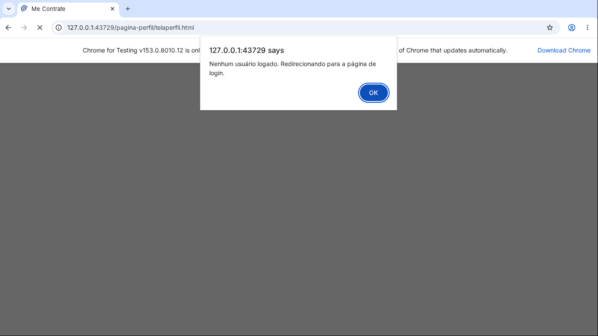
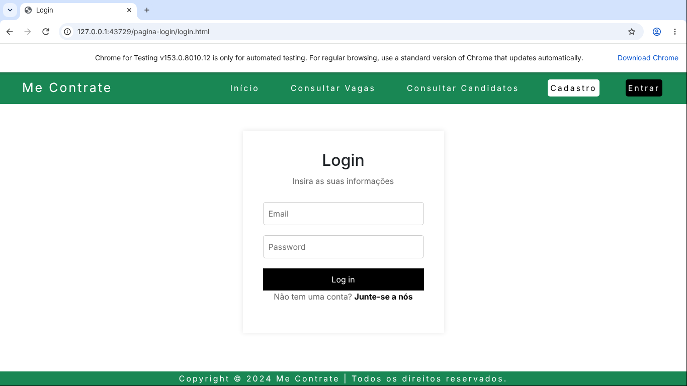

## CT28 – Empresa limpa as vagas cadastradas

**Pré-condição:** Empresa logada e uma vaga cadastrada (“Analista de QA”).

**Procedimento:**

1. O ator acessa a consulta de vagas.
2. O ator clica em “Limpar Vagas”.
3. O sistema remove as vagas cadastradas.

**Dados de entrada:** Vaga “Analista de QA”.

**Saída esperada:** Alerta “Todas as vagas foram limpas.”; vagas cadastradas removidas e as 6 fixas mantidas.

**Saída encontrada:** Alerta exibido; nenhuma vaga cadastrada e as 6 fixas mantidas.

**Prioridade:** Baixa · **Resultado:** Aprovado

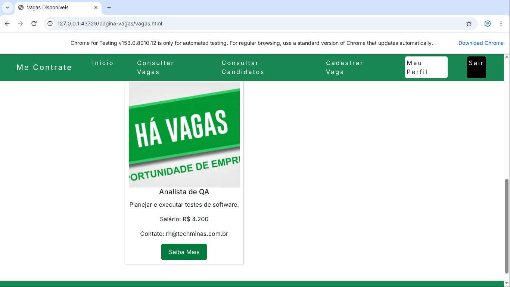
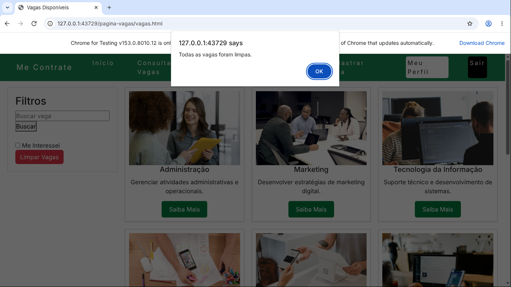

## CT29 – Página inicial em tela de celular (RNF-04)

**Pré-condição:** Navegador com área de 390 × 640 pixels (celular).

**Procedimento:**

1. O ator abre a página inicial.
2. O ator toca no botão de menu (hambúrguer).
3. O sistema expande o menu.

**Dados de entrada:** Largura de 390 px.

**Saída esperada:** Conteúdo ajustado à largura, sem rolagem horizontal, e menu recolhido acessível pelo botão.

**Saída encontrada:** Página com 390 px sem rolagem horizontal; o menu abre com todas as opções.

**Prioridade:** Média · **Resultado:** Aprovado

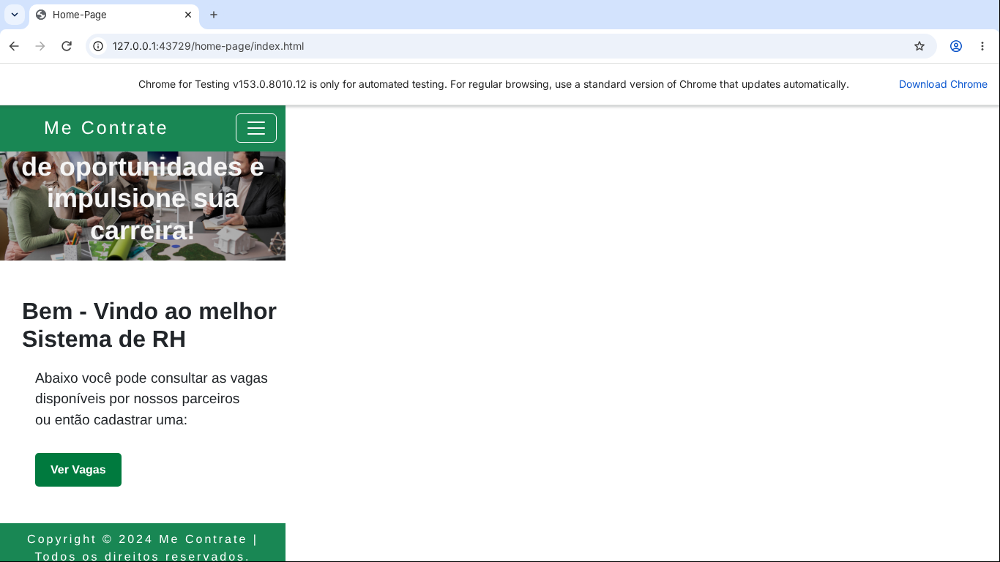
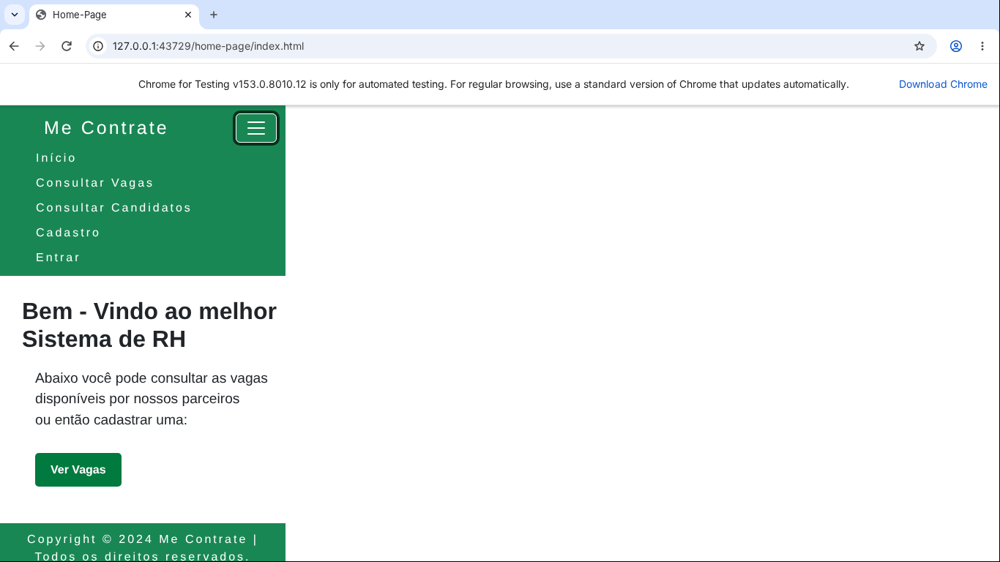

## CT30 – Cadastrar vaga sem estar logado

**Pré-condição:** Nenhum usuário logado.

**Procedimento:**

1. O ator acessa diretamente o endereço de cadastro de vaga.
2. O ator preenche o formulário.
3. O ator clica em “Cadastrar”.

**Dados de entrada:** Vaga “Vaga sem login”.

**Saída esperada:** Acesso negado e redirecionamento ao login, pois só empresas podem publicar vagas.

**Saída encontrada:** O formulário abre, o sistema exibe “Vaga cadastrada com sucesso!” e a vaga é publicada (defeito D07).

**Prioridade:** Alta · **Resultado:** Reprovado

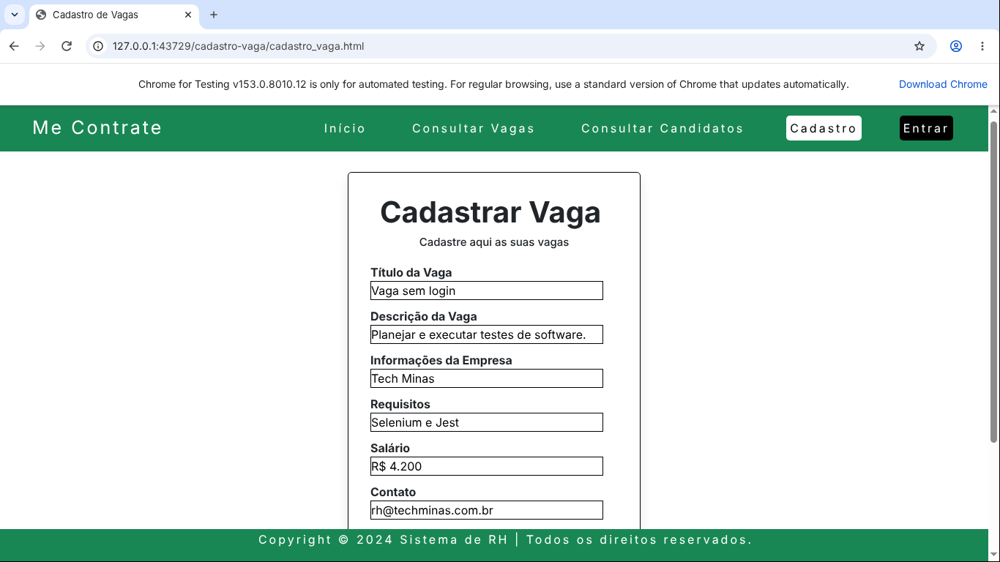
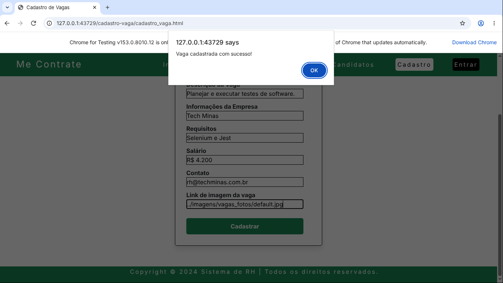
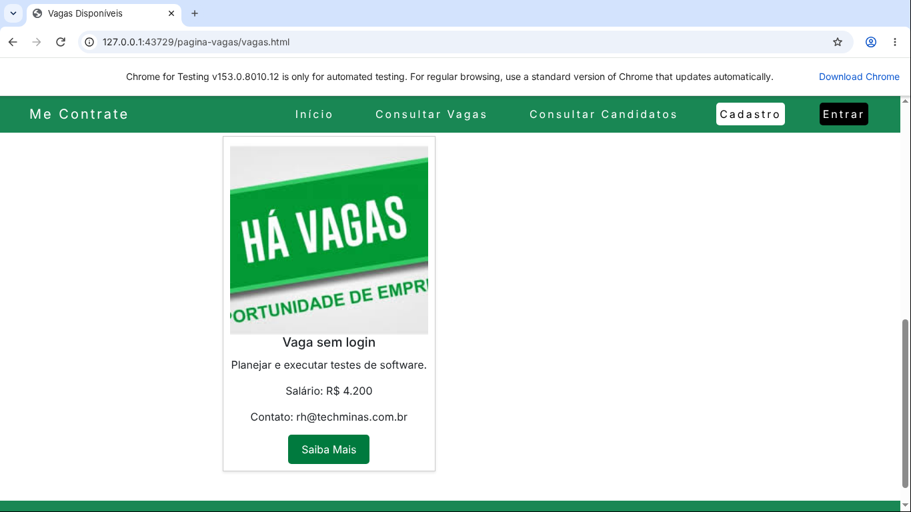
